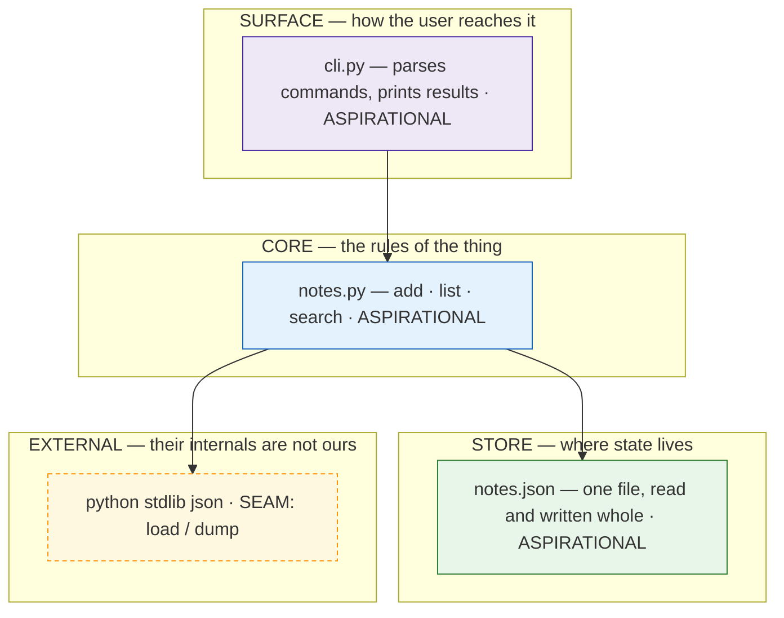

# 23 — THE ARCHITECTURE MAP IS THE STACK DIAGRAM

<docsys kind="arch-map" role="law+template"/>

TRIGGER:[a project gets its DESIGN.md (⇒ its stack is drawn THE SAME TURN — it needs no code) · any change to
DESIGN.md that adds, removes, renames or re-orders a layer, a component or a dependency (⇒ redraw the stack the
same turn) · a new dev flow (⇒ place it on the stack) · a new external dependency]
DO:[OPEN THE `archi-diagram` SKILL FIRST — the Skill tool, by its name, before the map's first write — and draw through it · keep ONE file per project,
`<project>/.claude/rules/21-architecture-diagrams.md` · draw THE STACK: the project's layers top to bottom as a
Mermaid `flowchart TB` — a `subgraph` per layer or boundary, arrows = dependency direction (who calls whom),
`classDef` colours per layer · draw it FROM DESIGN.md: every feature the design names is a box on the stack, so
the stack exists from the moment the design does, each unbuilt box marked `ASPIRATIONAL` · end every external
dependency AT ITS SEAM (one box: what it is + where it plugs in) · place every dev flow (`22-seq-*`) on the box it
runs through · one diagram per altitude, a section each, never a second file · build the bijective mapping
(general ↔ specific ↔ code, three interlocking columns, every concept in all three) for every system, blog or
treatise]
NOT:[leave the map a placeholder "until code exists" · let DESIGN.md and the stack disagree after any turn ·
expand a dependency's internals (they are its own architecture) · draw a box the design does not name]

THE SHAPE — a worked stack for a generic notes app; copy the form, fill in your own nouns:

